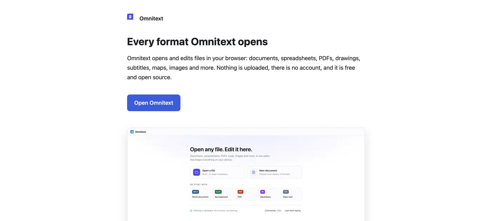
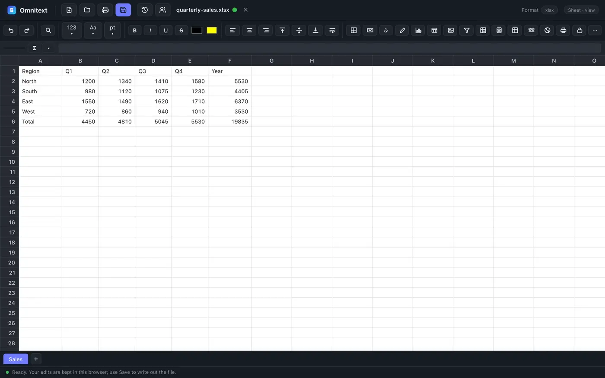
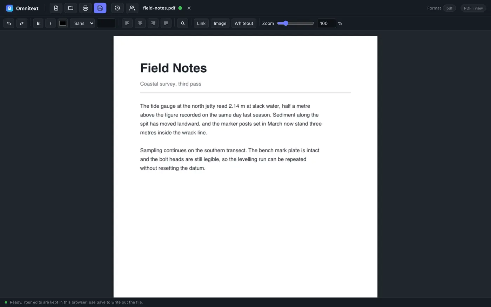
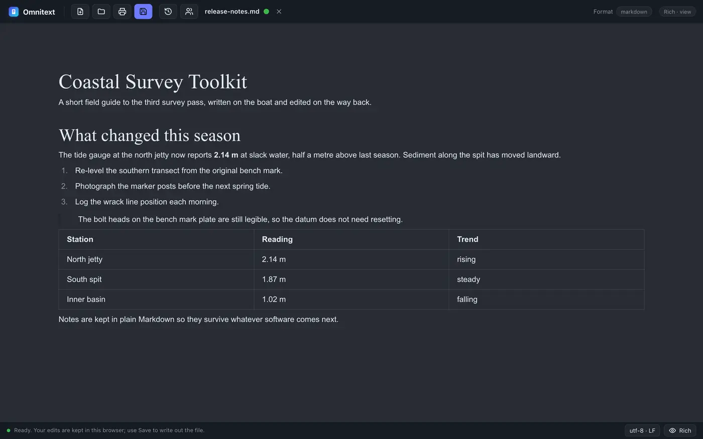
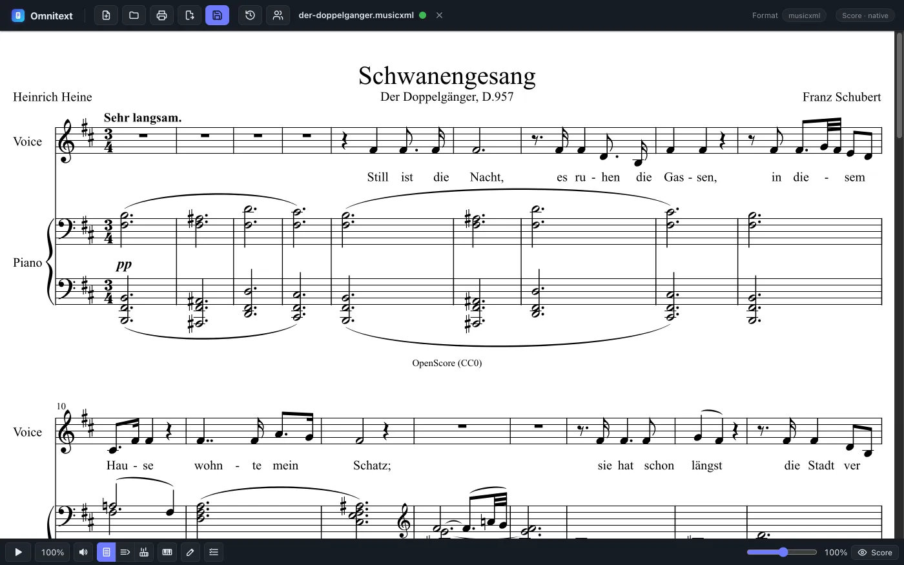
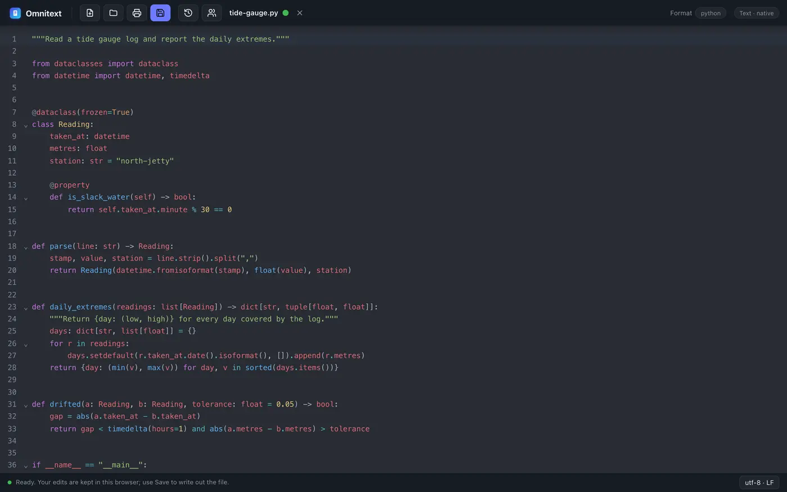

# Omnitext

**One free app that opens and edits practically any file, entirely in your browser.**

Documents, spreadsheets, PDFs, sheet music, code, images, maps, books, audio and video,
archives: Omnitext
picks the right editing surface for each file, lets you edit it, and saves it back. Nothing is
uploaded, there is no account, and no file ever fails to open.

**[▶ Open Omnitext](https://hikashop-nicolas.github.io/omnitext/)** &nbsp;·&nbsp;
[Every format it opens](https://hikashop-nicolas.github.io/omnitext/formats.html) &nbsp;·&nbsp;
[Google Play](https://play.google.com/store/apps/details?id=app.omnitext) &nbsp;·&nbsp;
[Android APK](https://github.com/hikashop-nicolas/omnitext/releases/download/android-latest/omnitext.apk)

<picture>
  <source srcset="public/shots/home-light.webp" media="(prefers-color-scheme: light)" />
  
</picture>

## Why you might like it

- **It opens the file you have.** Instead of one website for PDFs, another for spreadsheets
  and a third for images, one app handles them all, on your desktop and on your phone.
- **Your files stay with you.** There is no server, no account, no tracking and no cookie
  banner. The file is read by your browser and written back by your browser.
- **Free, with everything included.** No trial, no watermark, no paid tier, no ads.
- **It works offline.** Visit it once and it keeps working without a connection. Installed
  from your browser menu, it also joins your computer's "Open with" menu.
- **It speaks your language.** English, French, Japanese, Spanish, German, Portuguese,
  Russian and Simplified Chinese, picked automatically.
- **Your edits are kept.** Nothing is saved over your file until you say so, but the work in
  progress survives a crash or a closed tab.

## What it looks like

Spreadsheets keep their formulas, and Omnitext recalculates them as you type:

<picture>
  <source srcset="public/shots/sheet-light.webp" media="(prefers-color-scheme: light)" />
  
</picture>

PDFs are edited in place, so everything you did not touch stays exactly as it was:

<picture>
  <source srcset="public/shots/pdf-light.webp" media="(prefers-color-scheme: light)" />
  
</picture>

Markdown, Word documents and web pages open as rich text, with the raw source one click away:

<picture>
  <source srcset="public/shots/markdown-light.webp" media="(prefers-color-scheme: light)" />
  
</picture>

Sheet music is engraved, played and edited, with tab for guitar and falling notes for
practising at a keyboard:

<picture>
  <source srcset="public/shots/score-page-light.webp" media="(prefers-color-scheme: light)" />
  
</picture>

Code and configuration files get highlighting, folding and live checking, in about seventy
languages:

<picture>
  <source srcset="public/shots/code-light.webp" media="(prefers-color-scheme: light)" />
  
</picture>

## What it opens

A short tour. The [format list](https://hikashop-nicolas.github.io/omnitext/formats.html) has
a page for each one, generated from the app itself.

| | |
| --- | --- |
| **Documents** | PDF, Word (DOCX), OpenDocument (ODT), Markdown, HTML, LaTeX, RTF, PowerPoint, EPUB and other ebooks, Apple Wallet passes (boarding passes, tickets), SMART Health Cards |
| **Spreadsheets and data** | XLSX, ODS, XLSM with working macros, CSV, JSON, SQLite databases, Parquet, Jupyter notebooks |
| **Code and config** | About seventy languages, from JSON, YAML and XML to C, Rust, Go, Python and SQL |
| **Sheet music** | MusicXML and MXL, MuseScore (.mscz, .mscx), Guitar Pro 3 to 7, MIDI, ABC, and PDFs made by notation software, which open as editable scores |
| **Pictures** | PNG, JPEG, GIF, WebP, AVIF, HEIC from an iPhone, camera RAW, TIFF, PSD, SVG (with a full vector editor). Text recognition (OCR) on the device, which reads a photo or scan of printed music as a score |
| **Audio and video** | The usual web formats plus MKV, MOV, AVCHD and more, including Dolby and Apple Lossless audio that browsers normally refuse, with subtitles. Several files, a folder or a playlist (M3U, PLS, XSPF) play as one queue with next, previous, repeat and shuffle |
| **Maps** | GeoJSON, KML, KMZ and GPX in an interactive map editor, with measuring and drawing |
| **Subtitles** | SRT, WebVTT, ASS and SSA, with a waveform timeline, transcription and translation |
| **Archives** | ZIP, TAR, 7z, RAR and friends: browse them, open a file inside, or edit and put it back |
| **Everything else** | Unknown text opens as text, unknown binary opens as a hex view. Nothing ever fails to open. |

Files that can be edited are saved back in place: the parts you did not touch keep their
original bytes, down to the encoding and the line endings. A few formats are shown but not
edited (RTF, ebooks, camera RAW, MIDI and the other viewers above), and the app says so
instead of pretending.

## Sheet music

Scores open in an editor of their own, on a computer or a phone.
[A page per format](https://hikashop-nicolas.github.io/omnitext/formats.html) says
what each one can do.

- **Read and play.** See the score as pages, as one long line to play along with, or as notes
  falling onto a keyboard. It plays at once on a built-in sound; recorded instruments are
  downloaded the first time, after asking. Slow it down, show only your own part, and read
  guitar parts as tab.
- **Edit.** Enter notes from the computer keyboard, an on-screen piano or fretboard, or a MIDI
  keyboard. Add marks, dynamics, lyrics and chord symbols, change key, time and clef, add bars
  and instruments, transpose, or start a new score from the New dialog. MusicXML, MuseScore 3
  and 4 and Guitar Pro 7 files save back in place; MuseScore files keep everything you did not
  touch.
- **Practise with a MIDI keyboard.** The score waits for you to play each note, or runs in time
  and ends with a summary of what was on time, early, late, missed or wrong. In the browser,
  "Connect a MIDI keyboard" in the command palette asks for access (Chrome and Edge support
  Web MIDI); the Android app connects by itself.
- **Export** as MusicXML, MXL, Guitar Pro 7, MIDI, PDF, MP3 or WAV, or print on real pages. A
  PDF exported from Omnitext carries the score inside it and reopens as that exact score.
- **PDFs and scans.** A PDF engraved by MuseScore, Sibelius, Finale, LilyPond or Dorico opens as
  an editable score instead of a PDF. A photo or scan of printed music goes through the image
  viewer's OCR button, which recognises sheet music on its own and gives a draft score to
  correct; its small recognition model is downloaded the first time, after asking.

## Editing together

Share a link and two or more people edit the same file at once, in the same editor, seeing
each other's cursors. There is no server holding the document and no account: the link carries
the room, the browsers connect to each other directly, and the file goes from one machine to
another and nowhere else.

It works in the code editor, the subtitle editor, the spreadsheet, the rich text editor and
the PDF editor. Edits merge rather than overwrite, even inside the same paragraph, the same
cue or the same cell.

Two things are never done on your behalf: refreshing someone else's Power Query, which would
reach the network from your machine, and running someone else's macro. Their definitions
travel; running them is your decision.

## Privacy

Everything runs on your machine. Files never leave the browser, there is no server, no account
and no telemetry. That guarantee is the point of the project.

Collaboration keeps the promise for the document itself: peers connect directly and the file
passes between them. What is not private is the room. Finding each other uses a public relay,
which learns that some browsers are talking, and a session has no identity: names are
self-chosen, so a name says what someone typed, not who they are. Anyone with the link can
join.

## Installing it

- **In a browser**: just [open it](https://hikashop-nicolas.github.io/omnitext/). Your browser
  menu offers to install it, which also registers Omnitext in your desktop's "Open with" menu.
- **On Android**: [Google Play](https://play.google.com/store/apps/details?id=app.omnitext) is
  the easy route. The same app is also available as a
  [direct APK](https://github.com/hikashop-nicolas/omnitext/releases/download/android-latest/omnitext.apk),
  rebuilt from the latest source. Either way it appears in Android's "Open with" chooser, so
  any app can hand it a file.

On macOS, Chrome registers the installed app for the file types it edits, but tells macOS it
only views them, which keeps it out of Finder's recommended applications: it is there under
*All Applications*. Running `scripts/macos-editor-role.sh` claims those types as an editor and
puts Omnitext in the recommendations. Chrome rewrites its app on update, so run it again if the
app drops back out.

To make it the default for a file type, use Finder's *Get Info*, pick Omnitext under *Open
with*, and press *Change All*. Setting it on the file alone, through *Open With* and *Always
Open With*, binds that one file instead, and macOS refuses to open a downloaded file through
such a binding: Gatekeeper claims it cannot verify the file is free of malware. If a file is
already stuck that way, `xattr -d com.apple.quarantine <file>` opens it again.

Settings shows which build you are running, with a *Check for updates* button beside it.
Installed as an app, Omnitext keeps serving the build it has until every window is closed, so
a page never loses a piece it might still need. The button is how you say "now" instead of
waiting.

## For developers

Omnitext is MIT licensed, and so are the standalone editor libraries it is built on, which you
can embed in your own projects, commercial ones included:
[craftbridge](https://github.com/hikashop-nicolas/craftbridge) (the PDF editor's bridge to the [PdfCraft](https://github.com/storytold/pdfcraft) engine),
[richdoc](https://github.com/hikashop-nicolas/richdoc),
[sheetedit](https://github.com/hikashop-nicolas/sheetedit),
[geoedit](https://github.com/hikashop-nicolas/geoedit),
[subedit](https://github.com/hikashop-nicolas/subedit),
[imageview](https://github.com/hikashop-nicolas/imageview),
[mediaplay](https://github.com/hikashop-nicolas/mediaplay),
[scoredit](https://github.com/hikashop-nicolas/scoredit) and
[walletview](https://github.com/hikashop-nicolas/walletview).

The score editor, scoredit, engraves with
[OpenSheetMusicDisplay](https://github.com/opensheetmusicdisplay/opensheetmusicdisplay)
(BSD-3-Clause) and reads Guitar Pro files with
[guitarpro-parser](https://github.com/emilienbev/guitarpro-parser) (Apache-2.0). Its player
starts on a built-in sound ([webaudio-tinysynth](https://github.com/g200kg/webaudio-tinysynth),
Apache-2.0). Recorded instruments, after you allow them, are downloaded per instrument from
[scoredit-sounds](https://github.com/hikashop-nicolas/scoredit-sounds): the sounds of
[MuseScore_General](https://ftp.osuosl.org/pub/musescore/soundfont/MuseScore_General/) by
S. Christian Collins (MIT), played with [spessasynth](https://github.com/spessasus/spessasynth_core)
(Apache-2.0). MP3 export uses the [rusty_mp3](https://github.com/Remade-With-Rust/remade_ffmpeg_rs)
encoder (Apache-2.0) built to WebAssembly; PDF export uses [jsPDF](https://github.com/parallax/jsPDF)
and [svg2pdf.js](https://github.com/yWorks/svg2pdf.js) (both MIT); score PDFs are read with
[pdf.js](https://github.com/mozilla/pdf.js) (Apache-2.0).

Sheet music in photos and scans is read with the models in
[hikashop-nicolas/scoredit-scan](https://huggingface.co/hikashop-nicolas/scoredit-scan) on
Hugging Face, run by [onnxruntime-web](https://github.com/microsoft/onnxruntime) (MIT): a small
symbol network distilled from [oemer](https://github.com/BreezeWhite/oemer) (MIT), trained on
renders of [OpenScore](https://openscore.cc/) scores (CC0), and oemer's symbol classifiers,
trained by oemer's author on [DeepScoresV2](https://zenodo.org/record/4012193) (Tuggener et al.,
CC BY 4.0).

Architecture, the module system, the build and how to add a format or an editor:
**[docs/DEVELOPING.md](docs/DEVELOPING.md)**.

License: MIT.
